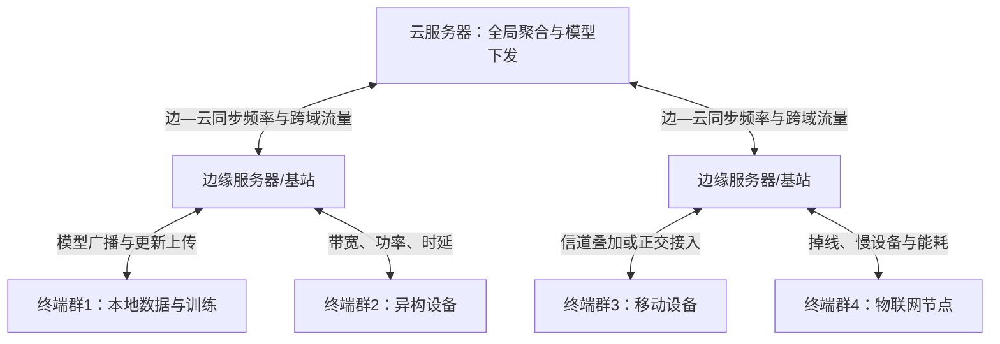
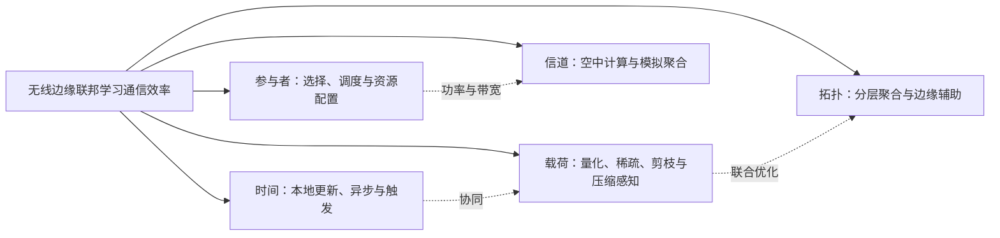

# 无线边缘网络中联邦学习通信效率优化方法研究综述

**英文题目：** A Review of Communication-Efficiency Optimization Methods for Federated Learning in Wireless Edge Networks

## 摘要

无线边缘网络中的联邦学习面临模型反复交换所造成的通信量、时延与能耗压力。本文从通信频率、客户端与资源、模型压缩、空中计算及分层聚合五个维度归纳通信效率优化方法，并比较其评价指标、适用场景和局限。分析表明，各类方法分别作用于轮数、载荷、参与过程、信道和拓扑，实际系统需在目标精度下联合权衡通信、计算与控制开销。现有研究仍缺少统一评价和动态无线环境验证。

**关键词：** 联邦学习；无线边缘网络；通信效率；模型压缩；分层聚合

## Abstract

Federated learning in wireless edge networks avoids centralizing raw data, yet repeated model exchanges impose communication-volume, latency, and energy costs. This review organizes communication-efficiency methods along five dimensions: communication-frequency control, client selection and resource allocation, model and gradient compression, over-the-air computation, and hierarchical or edge-assisted aggregation. These approaches optimize different quantities, including communication rounds, transmitted bits, participation cost, aggregation latency, and cross-tier traffic; their reported gains are therefore not directly interchangeable. Compression is suitable for large models and bandwidth-constrained links, scheduling addresses massive heterogeneous devices, over-the-air computation supports concurrent wireless aggregation, and hierarchical designs benefit networks with available edge infrastructure. Each approach may also introduce accuracy loss, computation, control signaling, or deployment costs. Meaningful evaluation should compare cumulative communication, end-to-end latency, energy consumption, and target accuracy under explicit system assumptions. Standardized benchmarks and evidence from dynamic wireless deployments remain necessary.

**Keywords:** federated learning; wireless edge networks; communication efficiency; model compression; hierarchical aggregation

## 1 引言

无线边缘网络中的联邦学习以模型交换代替原始数据汇聚，但通信压力并未消失。经典联邦平均（Federated Averaging，FedAvg）通过多步本地更新减少同步；受控实验显示，其达到目标精度所需的通信轮数比同步随机梯度下降减少10～100倍[1]。然而，移动终端受带宽、能量、算力和在线状态限制，高维模型的反复下发与上传仍会形成时延和能耗瓶颈；信道波动、非独立同分布数据及设备异构又使收敛与链路开销相互牵制[2][3][4]。因此，通信效率不能只看模型精度，还需考察通信轮数、累计传输量、端到端时延和能耗。

现有方法的主要差异在于其首先改变了哪一项通信要素。相关综述从模型压缩、通信机制、客户端选择及边缘资源等角度归纳了研究进展[2][3][5][6]，但压缩率、轮数、时延和能耗并不等价，脱离目标精度与系统假设进行排序容易产生误判。本文据此建立“时间—参与者—载荷—信道—拓扑”分类框架，分别对应通信频率控制、客户端选择与无线资源配置、模型和梯度压缩、空中计算以及分层式和边缘辅助联邦学习。

本文聚焦跨设备横向联邦学习在无线端—边—云环境中的通信效率问题。综述先统一系统流程与指标，再围绕五类优化杠杆横向比较原理、适用场景和局限。隐私、安全、激励及一般资源优化只在其改变通信成本或参与过程时作为约束讨论，不扩展为独立主线。

## 2 无线边缘网络中的联邦学习与通信开销

### 2.1 系统模型和基本流程

经典跨设备联邦学习采用“模型下发—本地训练—更新上传—服务器聚合”的轮次式流程。服务器抽取部分客户端并广播模型，客户端完成若干步本地优化后上传更新，服务器再加权聚合[1]。增加本地迭代适合链路昂贵而终端尚有算力的场景，但迭代过多会在非独立同分布数据上扩大客户端漂移；同步聚合还会受到慢设备和掉线影响。FedAvg由此建立了“以计算换通信”的基本路径，却没有直接刻画无线信道、字节量和能耗。

端—边—云分层和异步聚合可以缩短远距离交互，却会引入两级同步与参数陈旧问题。分层系统先在边缘侧局部聚合，再与云端低频同步，并可按终端能力配置不同复杂度的模型[7][8][9]；异步系统允许节点完成训练后立即提交更新[10][11]。其中，一项分层协同方案在特定异构物联网仿真中报告训练时间平均降低15%、精度提高6%、设备资源利用率提高52%[8]；一项异步机制将梯度通信次数压缩至原来的8.77%时，测试准确率下降0.03%[10]。这些结果说明结构与触发机制能够改变通信过程，但多组件耦合和特定实验条件限制了数值外推。

无线多址方式决定了更新是逐设备传输还是在信道中并发聚合。数字正交传输便于区分用户，但设备增多会增加资源占用与排队时延；空中计算利用多址信道的波形叠加直接获得更新之和，将传输和聚合合并[12][13][14]。与此同时，无线联邦学习还需要联合设计本地迭代、发射功率、带宽和资源预算[15][16]。因此，通信开销由模型大小、参与比例、同步频率、接入方式和聚合拓扑共同决定。

**图1 无线边缘联邦学习架构与通信瓶颈。** 作者根据文献[1][2][7][8][12]归纳绘制。

### 2.2 通信瓶颈及评价指标

通信开销应区分交互次数、单轮载荷和端到端系统成本。算法层常用达到目标精度所需轮数、单轮或累计比特数及压缩率；无线系统层还需考察时延、带宽、频谱效率和通信能耗。参与比例、模型规模、数据异构与两级同步频率会共同改变这些指标[3][15][16][17][18]，因此准确率相近不等于通信代价相近，单轮高压缩也不保证总训练时间更短。

现有实验进一步表明不同通信指标必须联合解读。稀疏三值压缩研究在两个图像分类数据集上分别报告约45倍和47倍单轮压缩，同时收敛约需100轮和490轮[17]；一比特压缩感知研究则在手写数字数据集上将单次上行量降至标准联邦学习的1/25，达到相同训练水平时，累计上传量和传输能耗分别降至2/11和1/10[18]。两项研究的模型、数据集和网络假设不同，不能仅按压缩倍数判断优劣。

较为稳妥的评价应在相同目标精度下同时报告累计通信成本与至少一项系统指标。轮数反映交互频率，比特数反映链路载荷，时延和能耗还受带宽、信道、终端计算与拓扑影响[19][20]。下文因此按主要作用对象分类，并在比较时同时考虑精度损失、附加计算和适用条件。

## 3 通信效率优化方法

五类方法分别从通信时间、参与主体、传输载荷、无线信道和聚合拓扑改变总成本。该分类按方法首先改变的通信量归类，混合方案的组合关系见第4章。

**图2 通信效率优化方法分类框架。** 作者根据前述文献及证据矩阵归纳绘制。

### 3.1 本地更新与通信频率控制

本地更新通过增加终端计算来减少全局同步，是通信频率优化的基本路径。FedAvg允许客户端在两次模型交换之间执行多步随机梯度下降[1]；资源受限边缘系统还可依据收敛界动态选择本地更新与全局聚合的比例[21]。周期平均与量化方法进一步结合部分参与和量化消息，说明频率与载荷可以联合设计[22]。这类方法适合链路昂贵而终端有算力的场景，但本地步数过多会放大客户端漂移，因而必须同时评价通信轮数、精度和计算时间。

自适应触发和异步聚合通过跳过低价值上传来适应训练状态变化。梯度阈值与异步权重可减少冗余通信[10]；边缘局部聚合与自适应梯度触发相结合时，特定实验中阈值为0.1可将平均通信次数由400次降至32次，平均准确率为0.9175[23]。另一类异步方法按更新到达顺序聚合部分边缘节点，并在带宽约束下调节聚合比例[11]。与固定周期相比，这些机制更灵活，但阈值过高或更新过旧均可能损害收敛。

单轮知识传递把减少轮数推向极端，同时把负担转移到生成与服务器训练。生成模型驱动方案只进行一轮通信，在两个受控数据集上将通信量分别降至FedAvg的1/10和1/100[24]。该方法适合频繁交互极其昂贵的场景，却依赖代理数据质量和额外计算。由此可见，频率控制的核心不是单纯减少轮数，而是在模型漂移、更新陈旧和本地计算之间寻找可接受边界。

### 3.2 客户端选择、调度与无线资源配置

客户端选择决定每轮“由谁参与”，其目标不应局限于挑选链路最快的设备。基于资源约束的选择方法按计算和无线条件筛选客户端[25]，无线调度分析表明参与规模、子信道带宽、干扰和调度策略会共同影响收敛[26]。长期选择与带宽分配还需考虑不同轮次的重要性和终端能量约束[27]，而通信—计算重叠及公平调度可缓解低时延选择对非独立同分布数据代表性的损害[28]。因此，设备选择应同时考虑数据效用、资源效用和参与公平性。

无线资源配置决定入选客户端以何种代价完成训练和上传。多联邦学习业务共存时，带宽需要在业务内部和业务之间分配[29]；分层网络还可通过博弈协调边缘关联与带宽[30]，或联合决定弱设备辅助训练、通信计算资源和模型稀疏度[31]。地面覆盖不足时，无人机辅助方法可调整计算频率、发射功率和本地模型精度，以优化安全约束下的能效[32]。这些方法贴近无线系统，但依赖较完整的设备、信道和队列状态，控制开销也可能抵消部分收益。

激励与安全机制只在改变参与过程和总通信成本时构成本节约束。主从博弈可在预算约束下影响终端参与及训练时延[33]，信誉筛选和区块链记录也能与异步资源分配结合[34]；但理性响应、状态可观测和共识消息都是附加假设。终端众多且异构性强时，客户端选择与资源配置应以达到目标精度的累计时延或能耗评价，而不是仅比较单轮上传速度。

### 3.3 模型和梯度压缩

模型和梯度压缩直接减少单次交换的数据量，是载荷维度的主要优化路径。量化降低参数表示位数，稀疏化与剪枝减少传输参数数量，压缩感知利用更新的稀疏结构传输低维测量值[17][18][20][22]。压缩通常不改变基本聚合流程，适合模型较大且带宽受限的场景；但压缩误差可能增加收敛轮数，编码、索引和重构也会消耗计算资源。

固定压缩率难以覆盖训练阶段和终端状态变化，自适应机制因而更具实用性。在线梯度稀疏化可依据通信—计算权衡调节稀疏度[35]，联合稀疏化和量化则可在目标精度与时延约束下优化设备总能耗[36]。中文研究中的梯度触发[23]和边缘辅助剪枝[31]也体现了类似思路。其共同局限是控制变量增多、状态估计成本上升，且不同论文所用“压缩率”“通信量”和“能耗”口径并不一致。

压缩与隐私保护的组合说明通信收益必须按总成本核算。重要梯度可经稀疏、压缩感知和量化后再用秘密共享保护[37]，但加解密、重构和额外交互不能被忽略。总体而言，压缩是证据较丰富且易与现有协议兼容的路径，但评价时仍应同时报告累计比特数、通信轮数、精度和端到端时延。

### 3.4 空中计算与模拟聚合

空中计算利用无线多址信道的波形叠加直接完成更新求和，从传输机制上合并通信与聚合。终端同时发送预处理后的模拟信号，边缘端从叠加波形中恢复聚合结果[12][13][14]。与逐用户正交传输相比，该方法更适合终端数量多、并发需求高的无线网络，其评价重点是聚合时延、频谱效率和聚合误差，而不是模型字节压缩率。

空中聚合的效率取决于信道对齐和接收误差。终端通常需要功率控制或预编码，弱信道设备可能受发射功率限制；噪声、信道估计和同步偏差也会进入聚合结果。时变多径信道研究进一步分析了正交频分复用系统中的载波间干扰[38]，稀疏一比特空中聚合则把量化、稀疏、误差反馈和功率控制联合起来[39]。这些进展扩展了空中计算的适用条件，也表明其收益高度依赖物理层假设，不能被概括为普遍优于数字传输。

### 3.5 分层式和边缘辅助联邦学习

分层联邦学习在终端与云之间加入边缘聚合层，以减少高频更新跨越远距离链路。端—边—云架构可让多个边缘服务器先完成局部聚合[7]，异构蜂窝网络还可结合梯度稀疏和周期平均[40]。量化分层联邦学习进一步揭示端—边与边—云传播时延会影响两级聚合间隔[41]，多簇系统还可将层次结构与空中聚合结合[42]。这类方法适合终端密集、接入关系明确且边缘基础设施可用的场景，但两级频率若不协调，局部模型偏移仍会影响全局收敛。

边缘辅助与模型异构可缓解弱设备和掉队问题。边缘服务器可替受限设备承担部分训练并联合调整资源和稀疏度[31]，不同复杂度的子模型也可适应算力、存储和通信差异[9]。后者在特定实验中报告准确率最高提高22%，但没有给出统一通信降幅，最大增益不能外推。2026年的层次化聚类蒸馏进一步通过客户端社区和服务器端知识融合减少重复参与[43]，其代理数据依赖和跨场景复现仍需后续检验。

分层结构还可与空中聚合组合以提高大规模无线接入能力。分层空中联邦学习同时处理多簇干扰、设备数据异构和上下行资源约束[42]，但系统复杂度、边缘负载和同步要求也随之增加。评价时应分别统计端—边与边—云流量、两级聚合频率、时延和额外计算，避免只报告局部链路节省。

## 4 不同优化方法的比较与适用场景

### 4.1 统一比较维度与方法权衡

五类方法改变的通信要素不同，不能用单一百分比直接排序。本地更新减少交互轮数，压缩降低单轮载荷，客户端调度改变参与代价，空中计算优化并发聚合，分层结构重组跨层流量。稀疏三值压缩报告约45倍和47倍单轮压缩[17]，分层协同方案报告平均训练时间降低15%[8]；二者分别度量载荷和时延，不能据此认定前者更高效。横向比较应以相同目标精度为前提，同时报告累计比特量、轮数、时延或能耗。

方法收益还必须扣除新增的计算与控制成本。压缩会产生编码、索引和重构开销，异步机制面临更新陈旧，客户端选择需要设备状态，空中聚合依赖信道估计与同步，分层方案还要协调两级频率。组合机制能够同时优化轮数、载荷和资源，却更难区分组件贡献，也更依赖准确状态信息。

| 方法类别 | 主要原理 | 主要通信指标 | 优点 | 局限 | 典型适用场景 |
|---|---|---|---|---|---|
| 本地更新与频率控制 | 增加本地步数、异步或事件触发 | 轮数、触发次数、训练时延 | 协议改动相对小，可直接减少交互 | 客户端漂移、陈旧更新、计算增加 | 链路昂贵且终端具有算力 |
| 客户端选择与资源配置 | 选择参与设备并分配带宽、功率和算力 | 单轮/累计时延、能耗、参与率 | 贴合无线异构条件，可兼顾公平 | 依赖状态信息，控制问题复杂 | 终端众多、信道与资源差异大 |
| 模型与梯度压缩 | 量化、稀疏、剪枝或压缩感知 | 比特数、压缩率、轮数 | 直接降低载荷，易与其他机制组合 | 压缩误差、索引和重构开销 | 大模型、窄带或低能耗终端 |
| 空中计算 | 利用信号叠加并发完成聚合 | 聚合时延、频谱效率、聚合误差 | 避免逐用户正交上传 | 对同步、信道估计和功率控制敏感 | 高并发且可协调的无线接入 |
| 分层与边缘辅助 | 边缘局部聚合、辅助训练和模型适配 | 两级流量、聚合间隔、时延 | 减少远距离通信并缓解掉队 | 部署、负载、信任和跨层协调成本 | 边缘节点充足、接入关系稳定 |

**表1 五类通信效率优化方法的横向比较。** 根据文献[7][10][17][25][36][39][41]归纳。

### 4.2 典型适用场景与组合策略

方法选择应由模型、终端、链路和边缘设施共同决定。大模型或窄带上行适合量化、稀疏化和压缩感知；海量异构终端需要联合客户端选择与资源配置；边缘节点充足且接入稳定时，可采用分层或边缘辅助聚合。空中计算适合高并发无线聚合，但其收益受噪声、功率和同步条件限制。

实际系统通常需要互补机制协同。通信昂贵且终端尚有算力时，可结合本地更新与轻量压缩；设备和信道波动较大时，可联动自适应触发、客户端选择与资源配置；大规模分层网络则可把量化或空中聚合嵌入局部聚合过程[22][27][39][41][42]。组合设计必须统计附加计算、控制消息和精度损失，否则局部改善可能掩盖总成本上升。

## 5 现有问题与发展趋势

### 5.1 现有研究的共性局限

现有结果难以横向比较，首先源于指标、基线和实验条件不一致。不同研究分别报告压缩倍数、轮数、时延或能耗，目标精度、模型和无线假设也不统一[2][3][5]。多数证据来自受控数据集和仿真网络，对数据异构与信道异构同时出现、终端移动和大规模掉线的考虑不足，多组件方案还难以归因。因此，现有数值主要说明特定设置下的可行性，不能直接形成跨方案排名。

系统附加开销统计不完整是另一项共性限制。秘密共享增加加解密与交互[37]，区块链共识带来额外通信和计算[34]，边缘辅助增加模型管理与控制消息[31]，空中计算则需要同步、信道估计和功率控制[38][39]。只有把这些代价计入累计比特量、总时延或总能耗，才能判断局部优化是否转化为系统收益。

### 5.2 发展趋势

通信效率优化将由单一机制转向自适应跨层协同。后续方案需要根据训练阶段、数据异构、信道和设备资源动态选择本地步数、压缩比例、参与客户端和聚合层级，并通过消融或统一基线区分各组件贡献[21][27][36][41]。隐私和安全也应作为可量化约束进入总成本，而不是脱离通信问题单独评价。

可部署性评价将成为跨层优化能否成立的关键。研究需统一记录累计比特量、轮数、频谱占用、时延、能耗和目标精度，并公开模型、数据分布、信道及设备状态。时变空中聚合、分层多簇网络和异构客户端蒸馏等近年方案[38][42][43]提供了更接近实际环境的研究方向，但仍需要跨平台复现和长期运行证据。

## 6 结论

无线边缘联邦学习的通信效率取决于时间、参与者、载荷、信道和拓扑五类杠杆。频率控制减少交互，客户端调度控制参与代价，模型压缩降低载荷，空中计算利用信道叠加，分层聚合重组跨层流量。各类方法均伴随计算、控制、部署或精度代价，不存在脱离场景的普遍最优方案。实际应用应围绕目标精度，依据模型、设备、信道和边缘基础设施，联合权衡累计通信量、端到端时延与能耗。

## 参考文献

[1] MCMAHAN B, MOORE E, RAMAGE D, et al. Communication-efficient learning of deep networks from decentralized data[C]//Proceedings of the 20th International Conference on Artificial Intelligence and Statistics. PMLR, 2017, 54: 1273-1282. https://proceedings.mlr.press/v54/mcmahan17a.html.

[2] 张雪晴, 刘延伟, 刘金霞, 等. 面向边缘智能的联邦学习综述[J]. 计算机研究与发展, 2023, 60(6): 1276-1295. DOI:10.7544/issn1000-1239.202111100.

[3] LIM W Y B, LUONG N C, HOANG D T, et al. Federated learning in mobile edge networks: A comprehensive survey[J]. IEEE Communications Surveys & Tutorials, 2020, 22(3): 2031-2063. DOI:10.1109/COMST.2020.2986024.

[4] NIKNAM S, DHILLON H S, REED J H. Federated learning for wireless communications: Motivation, opportunities, and challenges[J]. IEEE Communications Magazine, 2020, 58(6): 46-51. DOI:10.1109/MCOM.001.1900461.

[5] 葛丽娜, 王明禹, 田蕾. 联邦学习的高效性研究综述[J]. 计算机应用, 2025, 45(8): 2387-2398. DOI:10.11772/j.issn.1001-9081.2024081119.

[6] 张瑞麟, 杜晋华, 尹浩. 跨设备联邦学习中的客户端选择算法[J]. 软件学报, 2024, 35(12): 5725-5740. DOI:10.13328/j.cnki.jos.007085.

[7] LIU L, ZHANG J, SONG S H, et al. Client-edge-cloud hierarchical federated learning[C]//ICC 2020—2020 IEEE International Conference on Communications. IEEE, 2020: 1-6. DOI:10.1109/ICC40277.2020.9148862.

[8] 王汝言, 陈伟, 张普宁, 等. 异构物联网下资源高效的分层协同联邦学习方法[J]. 电子与信息学报, 2023, 45(8): 2847-2855. DOI:10.11999/JEIT220914.

[9] 钟正仪, 包卫东, 吴冠霖, 等. 一种面向云边端系统的分层异构联邦学习方法[J]. 计算机研究与发展, 2022, 59(11): 2408-2422. DOI:10.7544/issn1000-1239.20220458.

[10] 芦效峰, 廖钰盈, LIO P, 等. 一种面向边缘计算的高效异步联邦学习机制[J]. 计算机研究与发展, 2020, 57(12): 2571-2582. DOI:10.7544/issn1000-1239.2020.20190754.

[11] LIU J, XU H, XU Y, et al. Communication-efficient asynchronous federated learning in resource-constrained edge computing[J]. Computer Networks, 2021, 199: 108429. DOI:10.1016/j.comnet.2021.108429.

[12] 朱光旭, 李航. 面向高效通信边缘学习网络的通信计算一体化设计[J]. 中兴通讯技术, 2020, 26(4): 23-30. https://zxtx.cbpt.cnki.net/portal/journal/portal/client/paper/25c48c3c86cd8dbabd990499071ff8c6.

[13] AMIRI M M, GÜNDÜZ D. Machine learning at the wireless edge: Distributed stochastic gradient descent over-the-air[C]//2019 IEEE International Symposium on Information Theory. IEEE, 2019: 1432-1436. DOI:10.1109/ISIT.2019.8849334.

[14] ZHU G, WANG Y, HUANG K. Broadband analog aggregation for low-latency federated edge learning[J]. IEEE Transactions on Wireless Communications, 2020, 19(1): 491-506. DOI:10.1109/TWC.2019.2946245.

[15] TRAN N H, BAO W, ZOMAYA A, et al. Federated learning over wireless networks: Optimization model design and analysis[C]//IEEE INFOCOM 2019—IEEE Conference on Computer Communications. IEEE, 2019: 1387-1395. DOI:10.1109/INFOCOM.2019.8737464.

[16] DINH C T, TRAN N H, NGUYEN M N H, et al. Federated learning over wireless networks: Convergence analysis and resource allocation[J]. IEEE/ACM Transactions on Networking, 2021, 29(1): 398-409. DOI:10.1109/TNET.2020.3035770.

[17] 田金箫. 提升联邦学习通信效率的梯度压缩算法[J]. 计算机系统应用, 2022, 31(10): 199-205. DOI:10.15888/j.cnki.csa.008748.

[18] 章振宇, 谭国平, 周思源. 基于1-bit压缩感知的高效无线联邦学习算法[J]. 计算机应用, 2022, 42(6): 1675-1682. DOI:10.11772/j.issn.1001-9081.2021061374.

[19] MILLS J, HU J, MIN G. Communication-efficient federated learning for wireless edge intelligence in IoT[J]. IEEE Internet of Things Journal, 2020, 7(7): 5986-5994. DOI:10.1109/JIOT.2019.2956615.

[20] SATTLER F, WIEDEMANN S, MÜLLER K R, et al. Robust and communication-efficient federated learning from non-i.i.d. data[J]. IEEE Transactions on Neural Networks and Learning Systems, 2020, 31(9): 3400-3413. DOI:10.1109/TNNLS.2019.2944481.

[21] WANG S, TUOR T, SALONIDIS T, et al. Adaptive federated learning in resource constrained edge computing systems[J]. IEEE Journal on Selected Areas in Communications, 2019, 37(6): 1205-1221. DOI:10.1109/JSAC.2019.2904348.

[22] REISIZADEH A, MOKHTARI A, HASSANI H, et al. FedPAQ: A communication-efficient federated learning method with periodic averaging and quantization[C]//Proceedings of the Twenty Third International Conference on Artificial Intelligence and Statistics. PMLR, 2020, 108: 2021-2031. https://proceedings.mlr.press/v108/reisizadeh20a.html.

[23] 唐伦, 汪智平, 蒲昊, 等. 基于自适应梯度压缩的高效联邦学习通信机制研究[J]. 电子与信息学报, 2023, 45(1): 227-234. DOI:10.11999/JEIT211262.

[24] 郑赛, 李天瑞, 黄维. 面向通信成本优化的联邦学习算法[J]. 计算机应用, 2023, 43(1): 1-7. DOI:10.11772/j.issn.1001-9081.2021122054.

[25] NISHIO T, YONETANI R. Client selection for federated learning with heterogeneous resources in mobile edge[C]//ICC 2019—2019 IEEE International Conference on Communications. IEEE, 2019: 1-7. DOI:10.1109/ICC.2019.8761315.

[26] YANG H H, LIU Z, QUEK T Q S, et al. Scheduling policies for federated learning in wireless networks[J]. IEEE Transactions on Communications, 2020, 68(1): 317-333. DOI:10.1109/TCOMM.2019.2944169.

[27] XU J, WANG H. Client selection and bandwidth allocation in wireless federated learning networks: A long-term perspective[J]. IEEE Transactions on Wireless Communications, 2021, 20(2): 1188-1200. DOI:10.1109/TWC.2020.3031503.

[28] OZFATURA M E, ZHAO J, GÜNDÜZ D. Fast federated edge learning with overlapped communication and computation and channel-aware fair client scheduling[C]//2021 IEEE 22nd International Workshop on Signal Processing Advances in Wireless Communications. IEEE, 2021: 311-315. DOI:10.1109/SPAWC51858.2021.9593130.

[29] XU J, WANG H, CHEN L. Bandwidth allocation for multiple federated learning services in wireless edge networks[J]. IEEE Transactions on Wireless Communications, 2022, 21(4): 2534-2546. DOI:10.1109/TWC.2021.3113346.

[30] 范露露, 倪郑威, 李职杜. 联邦学习网络中基于分层博弈的边缘关联和资源分配[J]. 重庆邮电大学学报(自然科学版), 2025, 37(2): 261-272. https://cjournal.hep.com.cn/1673-825X/CN/1160179240370102516.

[31] 陈晓, 仇洪冰, 李燕龙. 边缘辅助的自适应稀疏联邦学习优化算法[J]. 电子与信息学报, 2025, 47(3): 645-656. DOI:10.11999/JEIT240741.

[32] 孟涛, 窦艳菲, 孙强, 等. 无人机辅助联邦学习安全传输能效优化[J]. 无线电工程, 2025, 55(9): 1861-1868. https://wxdg.cbpt.cnki.net/portal/journal/portal/client/paper/4fe4319debd9959f5fd3d3337f847ae5.

[33] 贾云健, 黄宇, 梁靓, 等. 基于主从博弈的分层联邦学习激励机制研究[J]. 电子与信息学报, 2023, 45(4): 1366-1373. DOI:10.11999/JEIT220175.

[34] 黄晓舸, 邓雪松, 陈前斌, 等. 边缘计算网络中区块链赋能的异步联邦学习算法[J]. 电子与信息学报, 2024, 46(1): 195-203. DOI:10.11999/JEIT221517.

[35] HAN P, WANG S, LEUNG K K. Adaptive gradient sparsification for efficient federated learning: An online learning approach[C]//2020 IEEE 40th International Conference on Distributed Computing Systems. IEEE, 2020: 300-310. DOI:10.1109/ICDCS47774.2020.00026.

[36] MARNISSI O, EL HAMMOUTI H, BERGOU E H. Adaptive sparsification and quantization for enhanced energy efficiency in federated learning[J]. IEEE Open Journal of the Communications Society, 2024, 5: 4307-4321. DOI:10.1109/OJCOMS.2024.3425531.

[37] 陈律君, 肖迪, 余柱阳, 等. 基于秘密共享和压缩感知的通信高效联邦学习[J]. 计算机研究与发展, 2022, 59(11): 2395-2407. DOI:10.7544/issn1000-1239.20220526.

[38] TEGIN B, DUMAN T M. Federated learning with over-the-air aggregation over time-varying channels[J]. IEEE Transactions on Wireless Communications, 2023, 22(8): 5671-5684. DOI:10.1109/TWC.2023.3235894.

[39] OH J, LEE D, WON D, et al. Communication-efficient federated learning over-the-air with sparse one-bit quantization[J]. IEEE Transactions on Wireless Communications, 2024, 23(10): 15673-15689. DOI:10.1109/TWC.2024.3432758.

[40] ABAD M S H, OZFATURA E, GÜNDÜZ D, et al. Hierarchical federated learning across heterogeneous cellular networks[C]//ICASSP 2020—2020 IEEE International Conference on Acoustics, Speech and Signal Processing. IEEE, 2020: 8866-8870. DOI:10.1109/ICASSP40776.2020.9054634.

[41] LIU L, ZHANG J, SONG S, et al. Hierarchical federated learning with quantization: Convergence analysis and system design[J]. IEEE Transactions on Wireless Communications, 2023, 22(1): 2-18. DOI:10.1109/TWC.2022.3190512.

[42] AZIMI-ABARGHOUYI S M, FODOR V. Scalable hierarchical over-the-air federated learning[J]. IEEE Transactions on Wireless Communications, 2024, 23(8): 8480-8496. DOI:10.1109/TWC.2024.3350923.

[43] ZHANG J, AN Z, WANG X, et al. FedCD: A communication-efficient federated learning framework via hierarchical cluster-distillation for heterogeneous edge clients[J]. Computer Networks, 2026, 288: 112611. DOI:10.1016/j.comnet.2026.112611.
