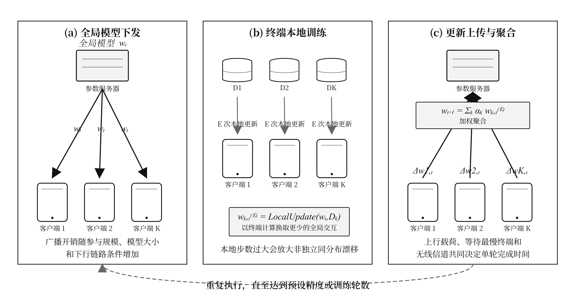
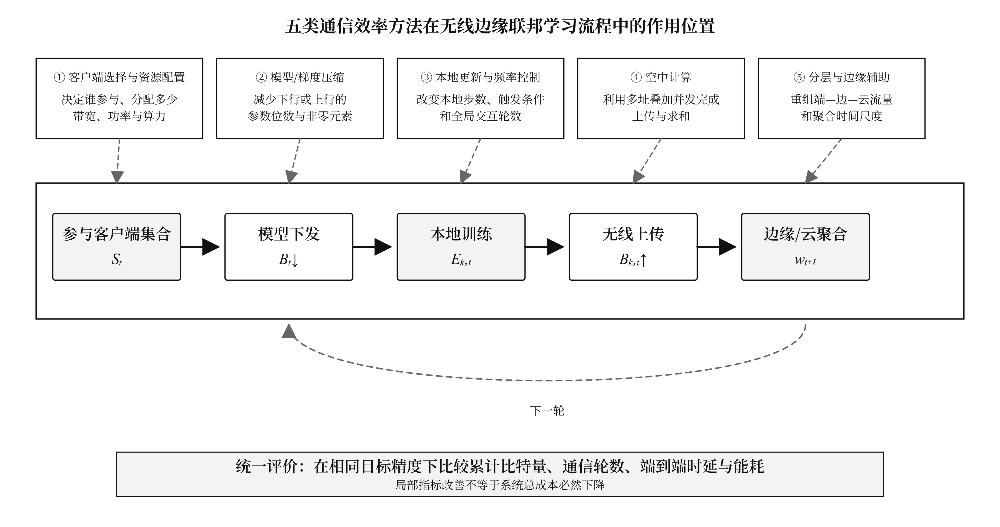
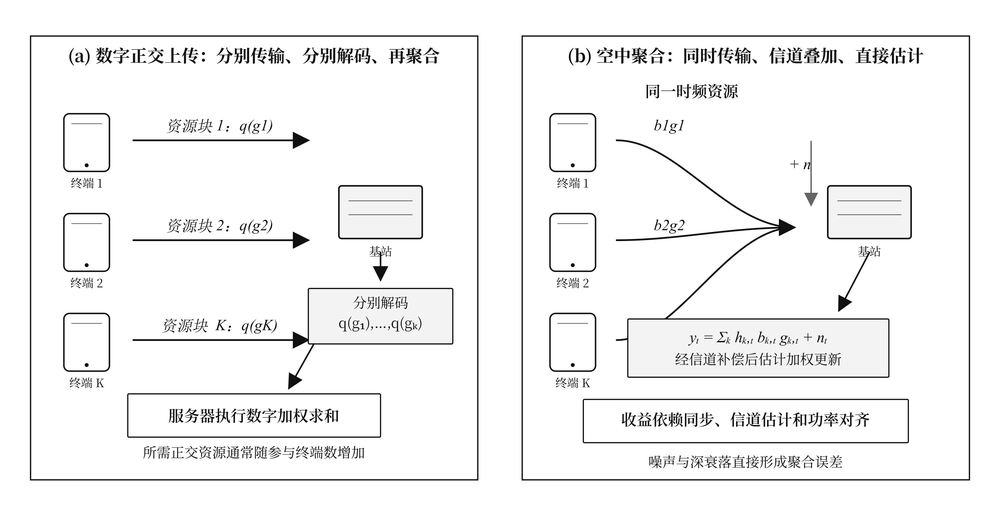
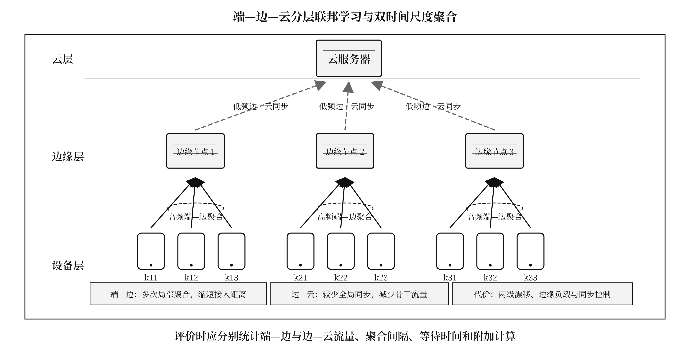

# 无线边缘网络中联邦学习通信效率优化方法研究综述

**英文题目：** A Review of Communication-Efficiency Optimization Methods for Federated Learning in Wireless Edge Networks

## 摘要

无线边缘网络中的联邦学习面临模型反复交换所造成的通信量、时延与能耗压力。本文从通信频率、客户端与资源、模型压缩、空中计算及分层聚合五个维度归纳通信效率优化方法，并比较其评价指标、适用场景和局限。分析表明，各类方法分别作用于轮数、载荷、参与过程、信道和拓扑，实际系统需在目标精度下联合权衡通信、计算与控制开销。现有研究仍缺少统一评价和动态无线环境验证。

**关键词：** 联邦学习；无线边缘网络；通信效率；模型压缩；分层聚合

## Abstract

Federated learning in wireless edge networks avoids centralizing raw data, yet repeated model exchanges impose communication-volume, latency, and energy costs. This review organizes communication-efficiency methods along five dimensions: communication-frequency control, client selection and resource allocation, model and gradient compression, over-the-air computation, and hierarchical or edge-assisted aggregation. These approaches optimize different quantities, including communication rounds, transmitted bits, participation cost, aggregation latency, and cross-tier traffic; their reported gains are therefore not directly interchangeable. Compression is suitable for large models and bandwidth-constrained links, scheduling addresses massive heterogeneous devices, over-the-air computation supports concurrent wireless aggregation, and hierarchical designs benefit networks with available edge infrastructure. Each approach may also introduce accuracy loss, computation, control signaling, or deployment costs. Meaningful evaluation should compare cumulative communication, end-to-end latency, energy consumption, and target accuracy under explicit system assumptions. Standardized benchmarks and evidence from dynamic wireless deployments remain necessary.

**Keywords:** federated learning; wireless edge networks; communication efficiency; model compression; hierarchical aggregation

## 1 引言

无线边缘网络中的联邦学习以模型交换代替原始数据汇聚，但反复交换高维参数仍会形成通信瓶颈。经典联邦平均（Federated Averaging，FedAvg）用多步本地训练减少全局同步；原始实验表明，其达到目标精度所需通信轮数可比同步随机梯度下降少10～100倍[1]。这一结果建立了“以终端计算换通信”的基本思路，却没有消除无线带宽有限、信道波动、设备掉线和能量受限等问题[2][3][4]。当模型规模、参与终端数和训练轮数同时增加时，模型下发与更新上传会共同推高累计比特量、等待时间和能耗。

通信效率优化的核心问题是识别系统中首先需要改变的通信要素。已有综述分别强调移动边缘架构、模型压缩、客户端选择和资源管理[2][3][5][6]，但“压缩倍数大”“通信轮数少”或“单轮时延低”并不等价。压缩可能增加收敛轮数，少选客户端可能损害数据代表性，空中聚合则可能把传输时延转化为聚合误差。因而，方法比较必须在相同目标精度和明确无线假设下，同时观察累计通信量、端到端时延和能耗。

本文围绕时间、参与者、载荷、信道和拓扑五个作用维度组织文献。正文先建立无线边缘联邦学习的目标函数与通信成本模型，再比较本地更新与频率控制、模型和梯度压缩、客户端选择与资源配置、空中计算以及分层与边缘辅助五类方法。隐私、安全、激励和一般资源优化仅在其改变通信量、参与过程或控制开销时作为约束讨论。

## 2 无线边缘网络中的联邦学习与通信开销

### 2.1 系统模型与基本流程

跨设备横向联邦学习的优化对象是分散在多个终端上的加权经验风险。设系统有 K 个客户端，第 k 个客户端持有 n_k 个样本，其局部损失为 F_k(w)，总样本数为 n。全局训练目标可写为式(1)[1][3][7][8]。

[[EQUATION 1 ../figures/v1.2/equations/eq01_global_objective.png 12.0]]

式(1)说明各客户端对全局模型的影响通常与本地样本量有关，但无线系统不必在每轮选择全部终端。服务器在第 t 轮选出参与集合 S_t，广播全局模型 w_t；客户端以学习率 η_t 执行 E 次本地随机梯度更新，再由服务器按样本量聚合，如式(2)所示[1]。

[[EQUATION 2 ../figures/v1.2/equations/eq02_local_and_fedavg.png 12.5]]

图1用于定位式(1)和式(2)中的变量，而不是重复装饰性地展示网络层次。子图(a)对应模型下发，子图(b)表示数据留在本地并完成多步更新，子图(c)对应更新上传和加权聚合；一次完整训练需要多轮重复这一过程。

**图1 无线边缘联邦学习的一轮训练及通信位置。** 根据文献[1][3][7][8]归纳改绘；客户端数量和箭头仅说明流程，不代表实验规模。

图1揭示的主要矛盾是交互频率与单轮代价相互耦合。增加本地步数可以减少全局轮数，但非独立同分布数据会放大客户端漂移；同步聚合能保持轮次一致，却会等待慢终端。异步方法允许完成训练的节点立即上传[9][10]，分层方法则在边缘侧先聚合再与云端同步[11]，两者分别引入参数陈旧和两级协调问题。

### 2.2 通信成本与评价指标

累计通信量应同时计入下发、上传和控制消息。令 T 为达到目标精度所需轮数，B↓(t) 为第 t 轮下发比特数，B↑(k,t) 为客户端上传比特数，Bctrl(t) 为调度、信道估计或协议控制开销，则可用式(3)统一描述通信量。

[[EQUATION 3 ../figures/v1.2/equations/eq03_total_communication.png 12.0]]

式(3)是一种比较口径，而非特定算法的性能结论。它说明减少单轮载荷只有在没有显著增加轮数和控制消息时，才会降低累计通信量；同理，少选客户端会降低当轮上传量，却可能因数据覆盖不足而增加总轮数。

无线链路把比特量进一步转化为时延和能耗。对带宽为 W(k,t)、发射功率为 p(k,t)、信道增益为 h(k,t) 的简化上行链路，上传时延可写为式(4)[7][8][12]。

[[EQUATION 4 ../figures/v1.2/equations/eq04_uplink_latency.png 12.5]]

式(4)表明相同比特量在不同带宽和信道条件下会产生不同等待时间，通信能耗还需乘以发射功率。因此，轮数、累计比特量、端到端时延和能耗不能互相替代。现有压缩实验也印证了这一点：稀疏三值方法在两个数据集上报告约45倍和47倍单轮压缩，但收敛轮数分别约为100轮和490轮[13]；一比特压缩感知方案在其手写数字实验中将单次上行量降至基线的1/25，累计上传量和传输能耗分别降至2/11和1/10[14]。这些数字只在各自模型、数据集和网络假设下成立，不能跨研究直接排名。

## 3 通信效率优化方法

五类方法的区别在于它们首先干预图1中的哪个环节。图2把方法映射回参与集合、模型下发、本地训练、无线上传和边缘/云聚合过程：客户端选择控制“谁参与”，压缩改变“传多少”，频率控制改变“多久交互一次”，空中计算改变“如何经信道求和”，分层结构改变“在哪一级聚合”[2][3][5][6][15]。

**图2 五类通信效率优化方法的作用位置。** 根据文献[2][3][5][6][15][16][17][18][19]归纳绘制；图中序号表示论述顺序，不表示性能排名。

图2的作用是防止把方法名称当作互斥标签。一项研究可以同时采用本地多步更新、梯度量化和客户端调度，也可以在分层网络的局部聚合中使用空中计算。此时应按式(3)和式(4)核算组合后的总成本，而不能把各组件分别报告的百分比简单相加。

### 3.1 本地更新与通信频率控制

本地多步更新通过增加终端计算减少全局同步，是频率维度的基础方法。FedAvg在两次通信之间执行多步随机梯度下降[1]，资源受限系统还可根据收敛状态动态选择本地步数和全局聚合频率[16]。FedPAQ把周期平均、部分参与和量化结合，说明轮数与单轮载荷可以联合优化[17]。这类方法适合链路昂贵、终端仍有计算余量的场景，但本地步数过多会加剧非独立同分布下的模型漂移。

事件触发与异步聚合通过跳过低价值或迟到更新改善动态参与。异步机制允许终端按完成顺序提交更新[9][10]；梯度阈值方案在其特定实验中把平均通信次数由400次降至32次，同时报告平均准确率0.9175[20]。这些方法比固定周期灵活，但阈值过高会遗漏有效更新，陈旧权重不当则可能使快速终端长期主导模型。

单轮联邦学习把通信频率压缩到一次，却把成本转移到知识生成和服务器训练。相关方案在两个受控数据集上报告通信量分别为FedAvg的1/10和1/100[21]，但依赖代理数据质量与额外生成计算。频率控制因此不能只比较轮数，还应同时报告本地计算时间、更新陈旧度和达到同一精度所需的总训练时间。

### 3.2 模型和梯度压缩

模型和梯度压缩直接减少式(3)中的单轮载荷。量化降低参数表示位数，稀疏化与剪枝减少非零元素，压缩感知则把具有稀疏结构的更新映射为更低维测量值[13][14][22][23][17]。为统一不同方法的口径，可用式(5)定义压缩后与原始比特数之比；ρ 越小表示单次传输越省，但不代表累计成本必然越低。

[[EQUATION 5 ../figures/v1.2/equations/eq05_compression_ratio.png 8.5]]

压缩方法的主要优点是能嵌入既有聚合协议，因而适合大模型和窄带终端。其主要限制是压缩误差、稀疏索引、编码与重构成本：过强压缩可能增加训练轮数，传输索引也会削弱稀疏收益。鲁棒压缩研究还表明，非独立同分布数据会改变压缩误差对收敛的影响[23]，所以式(5)必须和目标精度、轮数一起报告。

自适应压缩通过随训练阶段和资源状态调整 ρ 改善固定压缩率的局限。在线梯度稀疏化根据通信—计算权衡选择稀疏度[24]，联合稀疏化与量化方法则把目标精度、时延和设备能耗纳入优化[25]。秘密共享与压缩感知可以同时控制隐私和载荷[26]，但加解密、重构和额外交互均应计入总成本。压缩因而是兼容性较强的方案，却不能脱离编解码和收敛代价单独评价。

### 3.3 客户端选择、调度与无线资源配置

客户端选择决定每轮由谁参与，调度与资源配置决定入选终端以何种代价完成式(2)。按计算能力和无线条件筛选客户端可缩短当轮等待[18]，但只选链路最快的设备可能使数据代表性变差。无线调度研究表明，参与规模、子信道、干扰和数据分布共同影响收敛[27]；长期客户端选择还需兼顾能量约束和跨轮公平性[28]。

资源配置通过调整带宽、功率和计算频率直接改变式(4)中的速率和时延。通信—计算重叠与信道感知公平调度可以缩短空闲等待[29]，多个联邦学习业务共存时还需在业务之间分配带宽[12]。分层博弈可协调终端关联和资源[30]，边缘辅助方案可联合优化弱设备训练、模型稀疏度及通信计算资源[31]，无人机辅助场景则进一步涉及轨迹、功率和安全约束[32]。

这类方法的主要局限是状态依赖和控制开销。精细调度通常需要信道、队列、能量和数据效用信息；这些信息可能过期，收集本身也会消耗通信资源。主从博弈通过价格影响参与和训练时延[33]，区块链与信誉机制可约束异步参与[34]，但共识消息和理性响应假设同样构成附加成本。因此，终端众多且异构时，应以达到目标精度的累计时延或能耗评价，而非仅比较单轮上传速度。

### 3.4 空中计算与模拟聚合

空中计算把多址信道的叠加性质用于模型求和，其优化对象不是单个更新的文件大小，而是多终端并发聚合过程。数字正交上传先为客户端分配可分离资源，基站分别解码后再求和；空中聚合则让终端在同一时频资源上发送预处理波形，使接收信号直接包含更新之和[15][35][36]。两种过程的差别见图3。

**图3 数字正交上传与空中聚合的机理对比。** 根据文献[15][35][36][37][38]归纳改绘；图中未指定调制、编码、天线数和同步精度。

图3表明空中聚合的收益来自“同时传输并在信道中求和”，而不是省略无线误差。设 h(k,t) 为信道系数，b(k,t) 为终端预编码或功率系数，g(k,t) 为本地更新，基站接收信号可概括为式(6)[35][36][37][38]。

[[EQUATION 6 ../figures/v1.2/equations/eq06_aircomp.png 13.2]]

式(6)只有在同步、信道估计和功率对齐足够准确时，才近似目标加权和。时变多径会引入载波间干扰[37]，弱信道终端还可能因功率受限无法完成反演；稀疏一比特空中方案通过量化、稀疏、误差反馈和功率控制联合降低开销[38]，却增加了算法耦合。空中计算适合高并发且基站可统一协调的场景，其评价重点应是聚合时延、频谱占用和聚合误差，而非压缩比。

### 3.5 分层式和边缘辅助联邦学习

分层联邦学习通过增加边缘聚合层，把单一全局周期拆成端—边和边—云两种时间尺度。图4中，终端在接入范围内较高频地参与局部聚合，边缘节点再以较低频率与云端同步，从而避免每次更新都跨越远距离链路[11][39][19]。

**图4 端—边—云分层联邦学习与双时间尺度聚合。** 根据文献[11][39][19][40]归纳改绘；“高频”和“低频”仅表示相对关系。

图4中的两级加权过程可用式(7)概括。边缘节点 ℓ 先聚合簇 C_ℓ 内的客户端模型，再由云端对 L 个边缘模型聚合；权重 α 和 β 分别对应两个层级[11][39][19]。

[[EQUATION 7 ../figures/v1.2/equations/eq07_hierarchical.png 11.5]]

分层结构的直接收益是缩短高频接入距离并减少骨干链路同步，适合终端密集、接入关系较稳定且边缘节点充足的网络。一项异构物联网分层方案在其仿真中报告训练时间平均降低15%、精度提高6%、资源利用率提高52%[41]；模型异构方案可为不同能力终端配置不同复杂度子模型[42]。这些结果依赖具体拓扑和实验设置，不能视为所有分层系统的固定增益。

分层结构的主要代价是两级漂移、边缘负载和同步控制。量化分层联邦学习需要联合设计端—边与边—云间隔[19]，多簇空中分层方案还要处理簇间干扰和功率约束[40]。边缘辅助训练与聚类蒸馏可缓解弱设备和重复参与[31][43]，但会引入代理数据、模型管理和附加计算。评价时应分别统计两级流量和聚合间隔，而不能只报告云链路节省。

## 4 不同优化方法的比较与适用场景

### 4.1 统一比较维度与方法权衡

五类方法改变的通信要素不同，不能用单一百分比直接排序。本地更新减少交互轮数，压缩降低单轮载荷，客户端调度改变参与代价，空中计算缩短并发聚合过程，分层结构重组跨层流量。稀疏三值压缩的约45倍和47倍属于载荷指标[13]，分层方案报告的15%训练时间下降属于时延指标[41]；二者的分母、基线和系统假设不同，不能据此判定前者“更高效”。

方法收益必须扣除新增计算和控制成本。压缩产生编解码与索引，异步机制引入更新陈旧，客户端选择依赖状态上报，空中计算需要信道估计与同步，分层方案还要协调两级聚合。表1因此按原理、主要指标、优点、局限和场景统一比较，而不汇总跨论文的性能百分比。

| 方法类别 | 主要原理 | 主要通信指标 | 优点 | 局限 | 典型适用场景 |
|---|---|---|---|---|---|
| 本地更新与频率控制 | 增加本地步数、异步或事件触发 | 轮数、陈旧度、训练时延 | 协议改动较小，可直接减少交互 | 客户端漂移、更新陈旧、计算增加 | 链路昂贵且终端有算力 |
| 模型与梯度压缩 | 量化、稀疏、剪枝或压缩感知 | 单轮/累计比特数、轮数 | 直接降低载荷，易与其他机制组合 | 压缩误差、索引和重构开销 | 大模型、窄带或低能耗终端 |
| 客户端选择与资源配置 | 选择设备并分配带宽、功率和算力 | 时延、能耗、参与率、公平性 | 贴合无线异构条件 | 依赖状态信息，控制问题复杂 | 终端众多、资源差异大 |
| 空中计算 | 利用信号叠加并发完成聚合 | 聚合时延、频谱效率、聚合误差 | 避免逐用户正交上传 | 对同步、信道估计和功率控制敏感 | 高并发且可协调的无线接入 |
| 分层与边缘辅助 | 边缘局部聚合、辅助训练和模型适配 | 两级流量、聚合间隔、时延 | 减少远距离通信并缓解掉队 | 部署、负载、信任和跨层协调成本 | 边缘节点充足、接入关系稳定 |

**表1 五类通信效率优化方法的横向比较。** 根据文献[11][9][13][18][25][38][19]归纳。

### 4.2 典型适用场景与组合策略

方法选择应由模型规模、终端异构、无线链路和边缘设施共同决定。大模型或窄带上行优先考虑量化与稀疏；海量异构终端需要联合客户端选择和资源配置；边缘节点充足且接入关系稳定时适合分层聚合；空中计算则要求高并发接入、同步和信道协调能力。

组合优化应遵循“先确定瓶颈，再叠加机制”的顺序。通信昂贵而终端有算力时，可把本地多步更新与轻量压缩结合；信道和在线状态波动较大时，可联动事件触发、客户端选择和资源分配；分层网络还可在局部聚合中嵌入量化或空中计算[17][28][38][19][40]。组合方案必须报告消融结果和附加控制消息，否则无法判断收益来自哪个组件，也可能以局部节省掩盖总成本上升。

## 5 现有问题与发展趋势

### 5.1 现有研究的共性局限

现有结果难以横向比较，首先源于指标、基线和无线条件不一致。不同研究分别报告压缩倍数、轮数、时延或能耗，目标精度、模型规模、参与比例和信道模型也不统一[2][3][5]。多数证据来自受控数据集与仿真网络，对数据异构和信道异构同时出现、终端移动及大规模掉线的验证不足。因此，论文中的性能数字主要证明特定设置下可行，不能汇总成跨方案排名。

系统附加开销统计不完整是另一项共性限制。秘密共享增加加解密与交互[26]，区块链共识带来额外通信和计算[34]，边缘辅助增加模型管理和控制消息[31]，空中计算需要同步、信道估计和功率控制[37][38]。若这些代价未进入式(3)或总能耗，局部指标的改善不一定转化为系统收益。

### 5.2 发展趋势

通信效率优化将由单一机制转向训练—通信跨层自适应。后续方案需要依据训练阶段、数据异构、信道和终端资源动态选择本地步数、压缩比例、参与集合和聚合层级，并通过统一基线或消融实验区分组件贡献[16][28][25][19]。隐私和安全也应转化为可计量的消息、计算和时延约束，而不是脱离通信主线单独评价。

可部署性评价将成为方法能否成立的关键。研究应在同一报告中给出目标精度、累计比特量、轮数、频谱占用、端到端时延和能耗，并公开模型、数据划分、信道与设备状态。时变空中聚合、分层多簇网络和异构客户端蒸馏[37][40][43]正在接近动态环境，但仍需要真实设备、长期运行和跨平台复现证据。

## 6 结论

无线边缘联邦学习的通信效率由交互频率、参与集合、传输载荷、无线信道和聚合拓扑共同决定。五类方法分别减少轮数、控制参与代价、压缩载荷、利用信道叠加或重组跨层流量，但都会引入计算、控制、部署或精度代价。实际系统应先明确目标精度与主要瓶颈，再依据模型、终端、信道和边缘设施组合方法，并以累计通信量、端到端时延和能耗验证整体收益。

## 参考文献

[1] MCMAHAN B, MOORE E, RAMAGE D, et al. Communication-efficient learning of deep networks from decentralized data[C]//Proceedings of the 20th International Conference on Artificial Intelligence and Statistics. PMLR, 2017, 54: 1273-1282. https://proceedings.mlr.press/v54/mcmahan17a.html.

[2] 张雪晴, 刘延伟, 刘金霞, 等. 面向边缘智能的联邦学习综述[J]. 计算机研究与发展, 2023, 60(6): 1276-1295. DOI:10.7544/issn1000-1239.202111100.

[3] LIM W Y B, LUONG N C, HOANG D T, et al. Federated learning in mobile edge networks: A comprehensive survey[J]. IEEE Communications Surveys & Tutorials, 2020, 22(3): 2031-2063. DOI:10.1109/COMST.2020.2986024.

[4] NIKNAM S, DHILLON H S, REED J H. Federated learning for wireless communications: Motivation, opportunities, and challenges[J]. IEEE Communications Magazine, 2020, 58(6): 46-51. DOI:10.1109/MCOM.001.1900461.

[5] 葛丽娜, 王明禹, 田蕾. 联邦学习的高效性研究综述[J]. 计算机应用, 2025, 45(8): 2387-2398. DOI:10.11772/j.issn.1001-9081.2024081119.

[6] 张瑞麟, 杜晋华, 尹浩. 跨设备联邦学习中的客户端选择算法[J]. 软件学报, 2024, 35(12): 5725-5740. DOI:10.13328/j.cnki.jos.007085.

[7] TRAN N H, BAO W, ZOMAYA A, et al. Federated learning over wireless networks: Optimization model design and analysis[C]//IEEE INFOCOM 2019—IEEE Conference on Computer Communications. IEEE, 2019: 1387-1395. DOI:10.1109/INFOCOM.2019.8737464.

[8] DINH C T, TRAN N H, NGUYEN M N H, et al. Federated learning over wireless networks: Convergence analysis and resource allocation[J]. IEEE/ACM Transactions on Networking, 2021, 29(1): 398-409. DOI:10.1109/TNET.2020.3035770.

[9] 芦效峰, 廖钰盈, LIO P, 等. 一种面向边缘计算的高效异步联邦学习机制[J]. 计算机研究与发展, 2020, 57(12): 2571-2582. DOI:10.7544/issn1000-1239.2020.20190754.

[10] LIU J, XU H, XU Y, et al. Communication-efficient asynchronous federated learning in resource-constrained edge computing[J]. Computer Networks, 2021, 199: 108429. DOI:10.1016/j.comnet.2021.108429.

[11] LIU L, ZHANG J, SONG S H, et al. Client-edge-cloud hierarchical federated learning[C]//ICC 2020—2020 IEEE International Conference on Communications. IEEE, 2020: 1-6. DOI:10.1109/ICC40277.2020.9148862.

[12] XU J, WANG H, CHEN L. Bandwidth allocation for multiple federated learning services in wireless edge networks[J]. IEEE Transactions on Wireless Communications, 2022, 21(4): 2534-2546. DOI:10.1109/TWC.2021.3113346.

[13] 田金箫. 提升联邦学习通信效率的梯度压缩算法[J]. 计算机系统应用, 2022, 31(10): 199-205. DOI:10.15888/j.cnki.csa.008748.

[14] 章振宇, 谭国平, 周思源. 基于1-bit压缩感知的高效无线联邦学习算法[J]. 计算机应用, 2022, 42(6): 1675-1682. DOI:10.11772/j.issn.1001-9081.2021061374.

[15] 朱光旭, 李航. 面向高效通信边缘学习网络的通信计算一体化设计[J]. 中兴通讯技术, 2020, 26(4): 23-30. https://zxtx.cbpt.cnki.net/portal/journal/portal/client/paper/25c48c3c86cd8dbabd990499071ff8c6.

[16] WANG S, TUOR T, SALONIDIS T, et al. Adaptive federated learning in resource constrained edge computing systems[J]. IEEE Journal on Selected Areas in Communications, 2019, 37(6): 1205-1221. DOI:10.1109/JSAC.2019.2904348.

[17] REISIZADEH A, MOKHTARI A, HASSANI H, et al. FedPAQ: A communication-efficient federated learning method with periodic averaging and quantization[C]//Proceedings of the Twenty Third International Conference on Artificial Intelligence and Statistics. PMLR, 2020, 108: 2021-2031. https://proceedings.mlr.press/v108/reisizadeh20a.html.

[18] NISHIO T, YONETANI R. Client selection for federated learning with heterogeneous resources in mobile edge[C]//ICC 2019—2019 IEEE International Conference on Communications. IEEE, 2019: 1-7. DOI:10.1109/ICC.2019.8761315.

[19] LIU L, ZHANG J, SONG S, et al. Hierarchical federated learning with quantization: Convergence analysis and system design[J]. IEEE Transactions on Wireless Communications, 2023, 22(1): 2-18. DOI:10.1109/TWC.2022.3190512.

[20] 唐伦, 汪智平, 蒲昊, 等. 基于自适应梯度压缩的高效联邦学习通信机制研究[J]. 电子与信息学报, 2023, 45(1): 227-234. DOI:10.11999/JEIT211262.

[21] 郑赛, 李天瑞, 黄维. 面向通信成本优化的联邦学习算法[J]. 计算机应用, 2023, 43(1): 1-7. DOI:10.11772/j.issn.1001-9081.2021122054.

[22] MILLS J, HU J, MIN G. Communication-efficient federated learning for wireless edge intelligence in IoT[J]. IEEE Internet of Things Journal, 2020, 7(7): 5986-5994. DOI:10.1109/JIOT.2019.2956615.

[23] SATTLER F, WIEDEMANN S, MÜLLER K R, et al. Robust and communication-efficient federated learning from non-i.i.d. data[J]. IEEE Transactions on Neural Networks and Learning Systems, 2020, 31(9): 3400-3413. DOI:10.1109/TNNLS.2019.2944481.

[24] HAN P, WANG S, LEUNG K K. Adaptive gradient sparsification for efficient federated learning: An online learning approach[C]//2020 IEEE 40th International Conference on Distributed Computing Systems. IEEE, 2020: 300-310. DOI:10.1109/ICDCS47774.2020.00026.

[25] MARNISSI O, EL HAMMOUTI H, BERGOU E H. Adaptive sparsification and quantization for enhanced energy efficiency in federated learning[J]. IEEE Open Journal of the Communications Society, 2024, 5: 4307-4321. DOI:10.1109/OJCOMS.2024.3425531.

[26] 陈律君, 肖迪, 余柱阳, 等. 基于秘密共享和压缩感知的通信高效联邦学习[J]. 计算机研究与发展, 2022, 59(11): 2395-2407. DOI:10.7544/issn1000-1239.20220526.

[27] YANG H H, LIU Z, QUEK T Q S, et al. Scheduling policies for federated learning in wireless networks[J]. IEEE Transactions on Communications, 2020, 68(1): 317-333. DOI:10.1109/TCOMM.2019.2944169.

[28] XU J, WANG H. Client selection and bandwidth allocation in wireless federated learning networks: A long-term perspective[J]. IEEE Transactions on Wireless Communications, 2021, 20(2): 1188-1200. DOI:10.1109/TWC.2020.3031503.

[29] OZFATURA M E, ZHAO J, GÜNDÜZ D. Fast federated edge learning with overlapped communication and computation and channel-aware fair client scheduling[C]//2021 IEEE 22nd International Workshop on Signal Processing Advances in Wireless Communications. IEEE, 2021: 311-315. DOI:10.1109/SPAWC51858.2021.9593130.

[30] 范露露, 倪郑威, 李职杜. 联邦学习网络中基于分层博弈的边缘关联和资源分配[J]. 重庆邮电大学学报(自然科学版), 2025, 37(2): 261-272. https://cjournal.hep.com.cn/1673-825X/CN/1160179240370102516.

[31] 陈晓, 仇洪冰, 李燕龙. 边缘辅助的自适应稀疏联邦学习优化算法[J]. 电子与信息学报, 2025, 47(3): 645-656. DOI:10.11999/JEIT240741.

[32] 孟涛, 窦艳菲, 孙强, 等. 无人机辅助联邦学习安全传输能效优化[J]. 无线电工程, 2025, 55(9): 1861-1868. https://wxdg.cbpt.cnki.net/portal/journal/portal/client/paper/4fe4319debd9959f5fd3d3337f847ae5.

[33] 贾云健, 黄宇, 梁靓, 等. 基于主从博弈的分层联邦学习激励机制研究[J]. 电子与信息学报, 2023, 45(4): 1366-1373. DOI:10.11999/JEIT220175.

[34] 黄晓舸, 邓雪松, 陈前斌, 等. 边缘计算网络中区块链赋能的异步联邦学习算法[J]. 电子与信息学报, 2024, 46(1): 195-203. DOI:10.11999/JEIT221517.

[35] AMIRI M M, GÜNDÜZ D. Machine learning at the wireless edge: Distributed stochastic gradient descent over-the-air[C]//2019 IEEE International Symposium on Information Theory. IEEE, 2019: 1432-1436. DOI:10.1109/ISIT.2019.8849334.

[36] ZHU G, WANG Y, HUANG K. Broadband analog aggregation for low-latency federated edge learning[J]. IEEE Transactions on Wireless Communications, 2020, 19(1): 491-506. DOI:10.1109/TWC.2019.2946245.

[37] TEGIN B, DUMAN T M. Federated learning with over-the-air aggregation over time-varying channels[J]. IEEE Transactions on Wireless Communications, 2023, 22(8): 5671-5684. DOI:10.1109/TWC.2023.3235894.

[38] OH J, LEE D, WON D, et al. Communication-efficient federated learning over-the-air with sparse one-bit quantization[J]. IEEE Transactions on Wireless Communications, 2024, 23(10): 15673-15689. DOI:10.1109/TWC.2024.3432758.

[39] ABAD M S H, OZFATURA E, GÜNDÜZ D, et al. Hierarchical federated learning across heterogeneous cellular networks[C]//ICASSP 2020—2020 IEEE International Conference on Acoustics, Speech and Signal Processing. IEEE, 2020: 8866-8870. DOI:10.1109/ICASSP40776.2020.9054634.

[40] AZIMI-ABARGHOUYI S M, FODOR V. Scalable hierarchical over-the-air federated learning[J]. IEEE Transactions on Wireless Communications, 2024, 23(8): 8480-8496. DOI:10.1109/TWC.2024.3350923.

[41] 王汝言, 陈伟, 张普宁, 等. 异构物联网下资源高效的分层协同联邦学习方法[J]. 电子与信息学报, 2023, 45(8): 2847-2855. DOI:10.11999/JEIT220914.

[42] 钟正仪, 包卫东, 吴冠霖, 等. 一种面向云边端系统的分层异构联邦学习方法[J]. 计算机研究与发展, 2022, 59(11): 2408-2422. DOI:10.7544/issn1000-1239.20220458.

[43] ZHANG J, AN Z, WANG X, et al. FedCD: A communication-efficient federated learning framework via hierarchical cluster-distillation for heterogeneous edge clients[J]. Computer Networks, 2026, 288: 112611. DOI:10.1016/j.comnet.2026.112611.
